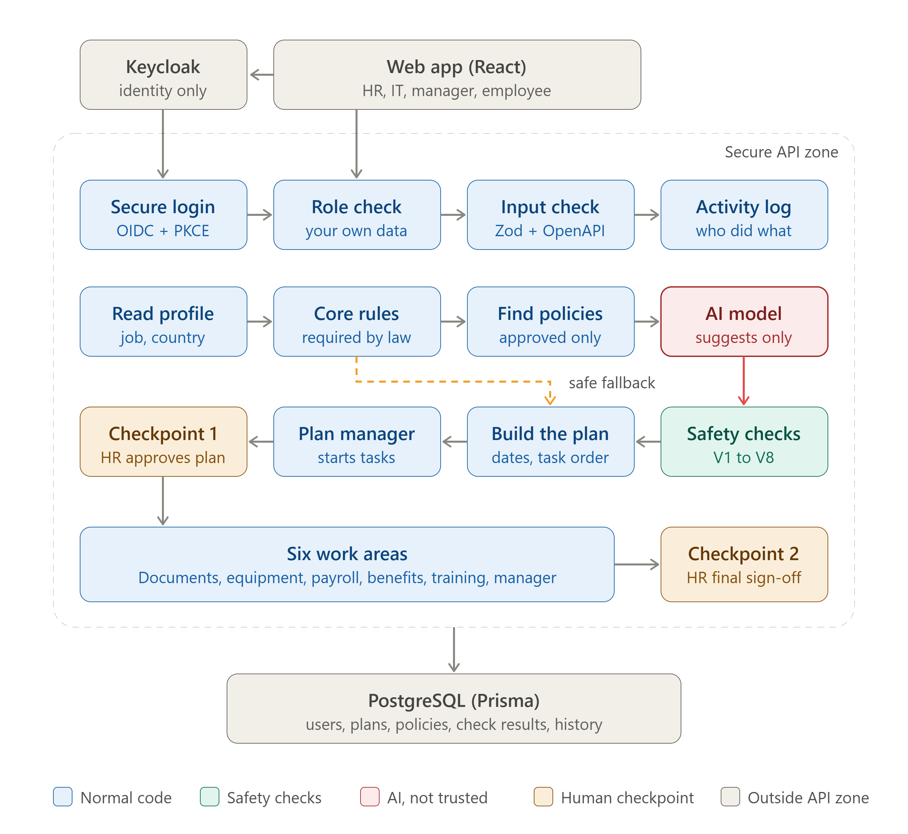

# CLYORA — Employee Onboarding Orchestrator

CLYORA coordinates employee onboarding across HR, managers, IT, finance, and employees. HR creates an employee profile, reviews and approves an onboarding plan, and tracks work through final sign-off. Each team gets a role-scoped workspace for the tasks it owns.

> **Project status:** This repository is an active project. The local development setup is documented below. A public deployment and presentation video have not yet been linked.

## Project links

| Resource | Link |
| --- | --- |
| Live deployment | **Coming soon** — add the public HTTPS URL when deployed. |
| Video presentation | https://www.loom.com/share/57e37b5edbe94a6688d5ce0363482b9b |
| Source code | [GitHub repository](https://github.com/LakshmiDeepak27/Employee-Onboarding) |
| API reference (local) | `http://localhost:4000/docs` after starting the API |

## Architecture



Keycloak authenticates users with OpenID Connect. CLYORA’s API verifies the identity, then applies roles and data scopes from PostgreSQL; Keycloak groups and token role claims do not grant application permissions. The orchestrator combines employee and approved policy context with deterministic checks. AI can suggest a plan, but cannot approve or dispatch it. HR approval is required before the plan creates downstream work.

## What it does

- Creates and tracks one onboarding plan per employee.
- Routes work to six areas: documents, equipment, payroll, benefits, training, and manager setup.
- Gives HR, IT, managers, and employees different workspaces and permissions.
- Checks task ownership, dependencies, policy scope, and dates before HR review.
- Records workflow activity for review and audit.
- Uses a baseline plan when an optional AI provider is unavailable; unsupported policy coverage is escalated instead of invented.
- Supports employee account activation through Keycloak email when its Admin API and SMTP are configured.

## Roles

| Role | Main responsibilities |
| --- | --- |
| HR administrator | Create employee records, review and approve plans, oversee progress, and complete final sign-off. |
| IT administrator | Fulfil equipment and access work assigned to IT. |
| Manager | Complete buddy, first-day, check-in, and goal-setting tasks for direct reports. |
| Employee | Complete assigned profile and document steps and track onboarding tasks, training, and benefits. |

## Technology

- **Web:** React, TypeScript, Vite
- **API:** Node.js, Express, TypeScript
- **Data:** PostgreSQL, Prisma
- **Identity:** Keycloak with OIDC Authorization Code flow and PKCE
- **Validation and API contract:** Zod and OpenAPI
- **Optional plan assistance:** Ollama or Gemini; deterministic baseline is available
- **Local services:** Docker Compose

## Run locally

### Prerequisites

- Node.js 22 or newer
- npm
- Docker Desktop (for PostgreSQL and local Keycloak)

### 1. Configure environment

From the repository root, copy the example environment file and edit `.env`:

```powershell
Copy-Item .env.example .env
```

Keep `.env` private and out of Git. For local PostgreSQL, the example database URLs work with the Compose defaults. Replace the development JWT secrets before using any shared or deployed environment.

### 2. Start PostgreSQL and Keycloak

```powershell
docker compose up -d db
npm run auth:up
```

Keycloak is available at `http://localhost:8080`. Its local development mode and default credentials are for local testing only. Set a private `KEYCLOAK_DEV_ADMIN_PASSWORD` in `.env` before starting it. The local configuration persists in the `keycloak_data` Docker volume.

### 3. Configure Keycloak OIDC

In the `employee-onboarding` realm, create an OpenID Connect client with ID `employee-onboarding-app`:

- Client authentication: **On** (confidential client)
- Standard flow: **On**
- Valid redirect URI: `http://localhost:4000/api/v1/auth/oidc/callback`
- Web origins: `http://localhost:5173` and `http://localhost:4000`
- PKCE code challenge method: `S256`

Copy the client secret into the API environment. Set these values in `.env` (replace the secret with the value from Keycloak):

```dotenv
OIDC_ISSUER_URL=http://localhost:8080/realms/employee-onboarding
OIDC_CLIENT_ID=employee-onboarding-app
OIDC_CLIENT_SECRET=<keycloak-client-secret>
OIDC_REDIRECT_URI=http://localhost:4000/api/v1/auth/oidc/callback
OIDC_SCOPES=openid profile email
```

The secret is server-side configuration; do not put it in frontend variables or commit it.

### 4. Install, migrate, seed reference data, and build

```powershell
npm run setup
```

This installs dependencies, generates the Prisma client, applies database migrations, seeds reference data and task templates, and builds the workspaces. It does **not** create sample users or employees.

To bootstrap the first HR application account, run a one-time seed with a work-style HR email:

```powershell
$env:BOOTSTRAP_HR_EMAIL = 'yourname.hr@clyora'
npm run db:seed
Remove-Item Env:BOOTSTRAP_HR_EMAIL
```

Then create the matching user in Keycloak, use the same email, mark the email verified, and set that user's password in Keycloak. The application database assigns the `hr_admin` role; do not grant application access through Keycloak roles. Use the HR account to provision other users through the application.

### 5. Start the API and web app

In separate terminals:

```powershell
npm run dev:api
```

```powershell
npm run dev:web
```

Open [http://localhost:5173](http://localhost:5173). Sign in using **Organization SSO**. The API runs at `http://localhost:4000`; interactive API documentation is at `http://localhost:4000/docs`.

## Typical onboarding walkthrough

1. **HR:** add an employee with their department, location, joining date, and manager.
2. **HR:** generate the plan, inspect validation findings, and approve it. Approval creates the service work.
3. **Manager and IT:** open their workspaces and complete their assigned tasks; dependencies and status are visible in the plan.
4. **Employee:** activate their account and complete assigned profile, document, training, and benefits steps.
5. **HR:** review outstanding work and record final completion approval.

For the employee activation email, configure a confidential Keycloak service-account client with only the required user-management permissions, then configure SMTP under **Realm settings → Email**. If these are not configured, HR can still create and manage the onboarding record, but Keycloak cannot send the activation link.

### Three-account presentation walkthrough

For a clean local walkthrough, keep the provisioned HR identity `asha.hr@clyora` and manager identity `david.manager@clyora`. The reset keeps those two CLYORA accounts, gives David the linked manager profile required for direct-report access, removes prior local employee/workflow records, and leaves HR to create one fresh employee from the app. The employee portal identity is created when HR sends the Keycloak activation invite, making three CLYORA application users for the walkthrough.

After starting the local database and Keycloak, preview and then clean non-staff human identities in the `employee-onboarding` realm. The realm's provisioning service accounts are preserved; the Keycloak admin-console account lives in the separate `master` realm and is not touched:

```powershell
npm run keycloak:clean:presentation
npm run keycloak:clean:presentation -- --apply
npm run db:seed:presentation
```

The database reset is guarded to localhost and is destructive: it removes other CLYORA users, employee profiles, prior plans/tasks, audit/session history and policy documents; it preserves Asha and David's accounts and recreates only David's manager profile. Do not point this command at a deployed database. Then sign in as HR, create the employee, choose David as manager, and send the activation email. The profile appears immediately in HR's directory and David's team. The invite adds the third CLYORA account; after the employee activates it, their portal shows the same plan and task progress. HR approval starts work, and HR's final sign-off marks the plan complete. Local policy records are illustrative and are labeled as samples in the UI.

## Useful commands

| Command | Purpose |
| --- | --- |
| `npm run dev:api` | Run the API in development mode |
| `npm run dev:web` | Run the Vite web application |
| `npm run setup` | Install, migrate, seed reference/task-template data, and build |
| `npm run db:deploy` | Apply committed Prisma migrations |
| `npm run db:seed:reference` | Seed reference data |
| `npm run db:seed:templates` | Seed onboarding task templates |
| `npm run auth:up` / `npm run auth:stop` | Start or stop local Keycloak |
| `npm run auth:logs` | View local Keycloak logs |
| `npm run build` | Build all workspaces |
| `npm run verify` | Run typecheck, lint, OpenAPI check, tests, and build |

## Optional AI configuration

The example configuration uses `LLM_PROVIDER=disabled`, so the baseline plan works without an AI API key. To enable assistance, configure `LLM_PROVIDER=ollama` with a reachable Ollama server or `LLM_PROVIDER=gemini` with `GEMINI_API_KEY`. Keep provider secrets on the API server. AI output remains subject to application validation and HR approval.

## Deployment

No public deployment is currently documented or verified. Before deploying, configure HTTPS, production-strength secrets, a reachable PostgreSQL database, persistent document storage, trusted CORS origins, and a production-ready identity provider/Keycloak deployment. Do not use Keycloak `start-dev` or the local Compose credentials in production. Review [the Docker configuration](docker-compose.yml) and [environment example](.env.example) against your hosting platform before release.

## Contributing

Contributions are welcome. Open an issue to describe a bug or proposed change, then submit a pull request with a focused explanation and the checks relevant to the change. Never include real employee data, credentials, tokens, database URLs, or private policy documents in an issue or pull request.

## Security

Do not report security vulnerabilities in public issues. Until a private security contact is published, contact the repository owner directly through GitHub. Never include secrets or real employee information in reports.

## License

No license file is currently included in this repository. Until the maintainer adds one, reuse and redistribution permissions have not been granted. Add a `LICENSE` file before presenting the repository as formally open source.
